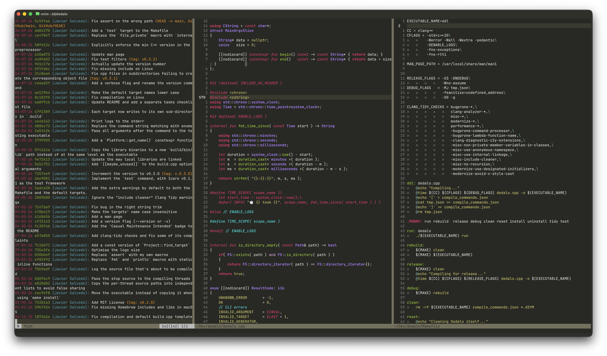

# Minikai

A minimalist fork of Neovim's [Unokai](https://github.com/neovim/neovim/blob/master/runtime/colors/unokai.vim), which in turn was based on Wimer Hazenberg's *Monokai*.

Too many colours in the syntax highlighting can easily become distracting and become counterproductive.
Minikai is designed to be a version of Monokai with a reduced colour palette, with the following changes:

- Comments are Cyan to make them stand out. If something was important or complex enough that couldn't be expressed just in code, it shouldn't fade into the background.
- Type names and declarations have the same colour: Purple.
- All literals, strings, numbers, and even enum cases share the same colour: Yellow.
- Macros and keywords are all Magenta.
- All variables, regardless of ownership (members, parameters, globals...) have the same colour: White.

